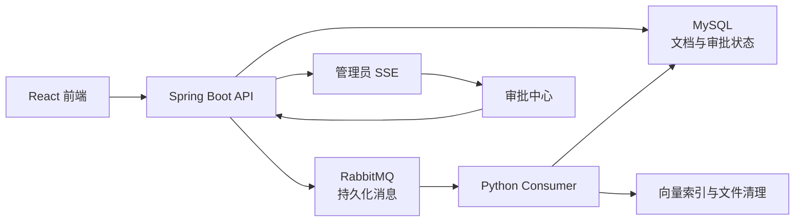

<div align="center">

# VigilDocs

**面向高风险操作审批的安全异步 RAG 知识库平台**

Durable RAG document processing with guarded human-in-the-loop workflows.

[](https://openjdk.org/)
[](https://spring.io/projects/spring-boot)
[](https://python.org/)
[](https://fastapi.tiangolo.com/)
[](https://reactjs.org/)
[](https://www.rabbitmq.com/)
[](https://mysql.com/)
[](LICENSE)
[](https://github.com/SaLaRiRy/vigil-docs/actions/workflows/ci.yml)

</div>

## 项目简介

VigilDocs 是一个基于 Spring Boot、FastAPI 和 React 的 RAG 知识库项目。它在原有 AgentCraft
项目基础上增加了持久化文档处理和高风险删除审批两条完整链路。

项目重点不只是“上传文档后做问答”，还包括：

- RabbitMQ 持久化文档处理与独立 Python Consumer。
- 三次有界重试、延迟重试队列和死信队列。
- 明确的文档处理状态和前端自动轮询。
- 管理员失败重试和持久化审计。
- 明确选择文档后发起删除审批。
- 管理员 SSE 审批通知和 MySQL 权威恢复。
- 审批票据与 Tool Registry 边界校验。
- 软删除、文件和向量清理，以及幂等重放保护。



## 核心能力

### 持久化文档处理

上传接口会先持久化文档元数据，再发布版本化 RabbitMQ 消息并立即返回。Python Consumer
负责解析、分块、向量化和 MySQL 持久化，使用手工 ack，并保证相同文档的重复消息不会产生
重复 chunks 或 vectors。

文档状态包括：

```text
PENDING -> PROCESSING -> COMPLETED
                    \-> FAILED
WAITING_APPROVAL -> DELETED
```

### 有界重试与死信恢复

- 最多执行 3 次。
- 非最终失败通过 TTL 重试队列再次投递。
- 最终失败进入 `agentcraft.document.dlq.v1`。
- 管理员可以对失败文档重新投递。
- 重复重试请求不会并发处理同一文档。

### 人工审批删除

用户必须明确选择文档后提交删除请求。系统会创建 durable run、step、approval 和 audit 记录，
进入 `WAITING_APPROVAL`，但不会立即删除。

管理员批准后：

1. 审批决定通过 RabbitMQ 发送到 Python Consumer。
2. Tool Registry 校验 tool、`runId`、`documentId` 和审批状态。
3. 文档先软删除为 `DELETED`。
4. 文件和向量清理异步执行。
5. run、step、tool call 和 cleanup 结果持久化审计。

重复审批、重复消息、已删除文档和执行中断恢复都按幂等方式处理。

### 安全边界

- Prompt Injection 使用窄范围启发式规则在删除流程前拦截并记录。
- SSE 只发送通知，不保存权威状态。
- 前端断线后从 MySQL 重新加载审批中心。
- 原有直接删除接口不再执行删除。

## 前端入口

| 页面 | 地址 | 主要能力 |
| --- | --- | --- |
| 用户知识库 | `/knowledge` | 上传、状态轮询、失败信息、请求删除 |
| 管理员知识库 | `/admin/knowledge` | 文档管理、失败重试 |
| 待审批操作 | `/admin/approvals` | SSE、批准、拒绝、幂等提交 |
| Agent 执行记录 | `/admin/agent-runs` | run、step 和真实 tool call 查询 |

原有聊天、仪表盘、用户管理、问答日志、知识巡检、自动报表和管理助手页面继续保留。

## 技术栈

| 层 | 技术 |
| --- | --- |
| 前端 | React 18、Vite、Axios |
| Java 后端 | Java 17、Spring Boot 3、Spring Security、MyBatis-Plus、Spring AMQP |
| AI 服务 | Python 3.10+、FastAPI、LangChain、DashScope/FAISS |
| 消息 | RabbitMQ |
| 数据 | MySQL、Redis |

## 本机启动

本项目的新功能验证不依赖 Docker。启动前需要本机运行 MySQL、Redis 和 RabbitMQ。

```powershell
powershell -NoProfile -ExecutionPolicy Bypass -File .\scripts\start-local.ps1
```

脚本会校验基础设施，并等待 Python API、Python Consumer、Java 后端和前端就绪。
运行日志写入 `.runtime/`。

启动后访问：

- 用户端：`http://127.0.0.1:3000/login`
- 管理员端：`http://127.0.0.1:3000/admin/login`
- 审批中心：`http://127.0.0.1:3000/admin/approvals`

## 验收流程

```powershell
python-service\.venv\Scripts\python.exe .\scripts\demo_acceptance.py
```

固定验收覆盖：

- 有效文档到达 `COMPLETED`。
- 损坏 PDF 执行三次失败并进入 DLQ。
- Prompt Injection 被拒绝并写入审计。
- 新审批通过 SSE 到达管理员。
- 审批、重复审批、软删除和清理完成。
- 工具调用只执行一次。
- 拒绝审批不会删除文档。

## 测试与 CI

```powershell
python-service\.venv\Scripts\python.exe -m pytest python-service\tests -q
```

```powershell
$env:JAVA_HOME='C:\Program Files\JetBrains\IntelliJ IDEA 2023.1\jbr'
mvn test
```

```powershell
cd frontend
npm run build
```

当前基线：

- Python：130 个测试通过。
- Java：10 个测试通过。
- 前端 production build 通过。
- GitHub Actions 包含 Python、Java 和 Frontend 三个任务。

## 文档

- [本机演示与验收](docs/mvp-demo.md)
- [二次开发工作总结](docs/mvp-implementation-summary.md)
- [二开评估与许可合规](二开评估与许可合规.md)
- [AgentCraft 学习指南](AgentCraft学习指南.md)
- [新手友好食用指南](新手友好食用指南.md)

## 许可证与致谢

VigilDocs 基于 [EvanYao826/AgentCraft](https://github.com/EvanYao826/AgentCraft)
二次开发。上游代码和本项目继续采用 [Apache License 2.0](LICENSE)。

原始版权和署名声明予以保留。自 2026 年起对 VigilDocs 的修改由 SaLaRiRy 维护，
修改部分的版权归 SaLaRiRy 所有。完整声明见 [NOTICE](NOTICE)。
