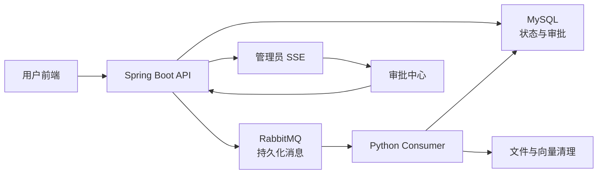

# VigilDocs 二次开发工作总结

## 1. 这次二开解决了什么

本次二开在原有 RAG 问答项目上增加了两条完整、可演示的纵向功能链路：

1. 文档处理从 Java 进程内异步任务升级为 RabbitMQ 持久化异步链路。
2. 文档删除从直接删除升级为人工审批后执行的高风险操作。

目标不是重写整个 Agent 平台，而是在不破坏原有问答路径的前提下，补上一套真实的可靠处理、审批、审计和本地验收闭环。



## 2. 最终增加的正式能力

### 2.1 持久化异步文档处理

- 文档上传后先写入 `knowledge_doc`，状态为 `PENDING`。
- Java 发布版本化 RabbitMQ 消息，不再在 Java 请求内调用文档解析。
- 独立 Python Consumer 负责解析、分块、向量化和 MySQL 持久化。
- Consumer 使用手工 ack：成功时在 `COMPLETED` 提交后确认；失败时先持久化 `PENDING`/`FAILED` 并把重试或 DLQ 消息持久化发布，再确认原消息。
- 重复投递会按 `documentId` 替换 chunks/vectors，避免重复数据。
- 发布失败会把文档标记为 `FAILED`，不会静默停留在 `PENDING`。

### 2.2 有界重试和死信恢复

- 处理失败最多执行 3 次。
- 非最终失败回到 `PENDING`，通过带 TTL 的延迟重试队列再次投递。
- 第 3 次失败后标记 `FAILED`，进入 `agentcraft.document.dlq.v1`。
- 管理员可以从失败文档发起重新处理。
- 重试使用状态条件更新，重复点击不会并发启动同一文档的多个处理任务。

### 2.3 受保护的单文档删除

- 用户必须明确选择某个文档后发起删除请求，文档 ID 作为结构化路径参数传递。
- 后端创建持久化 run、step、audit 和 approval 记录。
- 删除请求先进入 `WAITING_APPROVAL`，不会直接调用删除工具。
- 审批记录包含请求人、文档、工具、清洗后的参数、风险原因、`runId`、`traceId`、创建时间、30 分钟过期时间和审批字段。
- 明显 Prompt Injection 输入会被安全拒绝并写入审计。
- 原有用户端和管理端直接删除接口不再执行物理删除。

### 2.4 管理员审批与安全执行

- 管理员可以批准或拒绝待处理请求，并可填写审批意见。
- 重复提交相同决定返回幂等结果。
- 审批决定通过 RabbitMQ 传递给 Python 执行端。
- `delete_document` 属于 destructive tool，Tool Registry 会校验审批票据。
- 审批必须同时匹配工具名、`runId` 和 `documentId`。
- 批准后只做软删除，文档记录保留，状态改为 `DELETED`。
- 文件和向量清理在软删除后执行，清理结果单独记录；chunks 与文档审计记录保留，不覆盖删除历史。
- 已删除文档或已完成审批的重放请求会安全返回 no-op。

### 2.5 审批通知与审计

- 新审批请求通过管理员 SSE 实时通知。
- SSE 只负责通知，MySQL 始终是审批权威数据源。
- 前端断线后会重新加载 MySQL 中的待审批列表。
- run、step、approval、tool call、guardrail、删除和清理结果均可按 `runId` / `traceId` 查询。

### 2.6 本机启动和固定验收

- 新增 PowerShell 本机启动脚本，不使用 Docker。
- 启动前校验 MySQL、Redis、RabbitMQ。
- 启动后等待 Python API、Python Consumer、Java 和前端就绪。
- 新增有效文档、损坏 PDF、Prompt Injection 三组固定 fixtures。
- 新增可重复执行的全栈验收脚本。

## 3. 前端页面可以直接看到的功能

| 页面或入口 | 用户能看到的变化 | 说明 |
| --- | --- | --- |
| 用户知识库 `/knowledge` | `排队中`、`处理中`、`已完成`、`失败`、`等待审批`、`已删除` 状态 | 原列表现在展示真实异步处理状态 |
| 用户知识库 `/knowledge` | 活跃文档每 2 秒自动刷新 | 不需要手动刷新就能看到处理进度 |
| 用户知识库 `/knowledge` | 失败原因摘要 | `FAILED` 文档会显示后端返回的用户安全错误信息 |
| 用户知识库 `/knowledge` | “请求删除”按钮 | 点击后创建审批请求，不再直接删除 |
| 用户知识库 `/knowledge` | 等待审批和已删除状态禁用删除按钮 | 防止同一文档重复发起无效请求 |
| 管理员知识库 `/admin/knowledge` | 失败文档的“重试”操作 | 管理员可重新投递处理消息 |
| 管理员知识库 `/admin/knowledge` | 删除按钮禁用 | 删除必须走审批中心，页面不再提供旁路 |
| 管理员导航 | 新增“待审批操作” | 新审批中心的入口 |
| 审批中心 `/admin/approvals` | 待审批文档、请求人、风险原因、`runId`、`traceId`、过期时间 | 管理员可据此做出决定 |
| 审批中心 `/admin/approvals` | 批准、拒绝、审批意见、提交中禁用 | 重复点击或网络重试不会重复执行删除 |
| 审批中心 `/admin/approvals` | SSE 实时刷新与断线恢复 | 新请求无需手动刷新，重连后以 MySQL 状态为准 |
| Agent 执行记录 | 工具调用数据可查询 | 原占位接口现在返回真实 `tool_call` 记录 |

原有以下页面仍保留，没有做整体重构：

- 用户登录、注册、聊天问答。
- 管理员登录、仪表盘、用户管理、问答日志。
- Agent 执行记录、知识巡检、自动报表、管理助手。

## 4. 对原项目行为的实质修改

### 4.1 上传路径

修改前：

```text
KnowledgeController.upload
  -> KnowledgeServiceImpl.uploadDoc
  -> aiService.parseDocument
  -> Java 进程内异步解析
```

修改后：

```text
KnowledgeController.upload
  -> KnowledgeServiceImpl.uploadDoc
  -> 写 knowledge_doc = PENDING
  -> 发布 RabbitMQ 消息
  -> 立即返回
```

`POST /api/knowledge/upload` 和 `GET /api/knowledge/list` 两个现有前端接口路径保持不变，因此没有推翻原前端调用方式。

### 4.2 删除路径

修改前：

```text
DELETE /api/knowledge/{id}
  -> 删除文件/向量
  -> 删除 knowledge_doc
```

修改后：

```text
POST /api/knowledge/{id}/deletion-request
  -> 创建 run + approval
  -> WAITING_APPROVAL
  -> 管理员批准
  -> RabbitMQ
  -> Tool Registry 审批校验
  -> knowledge_doc = DELETED
  -> 异步清理文件和向量
```

原来的用户端和管理端直接删除接口仍存在，但只返回“必须通过审批”的业务错误，不再执行物理删除。

### 4.3 管理端失败重试

`POST /api/admin/knowledge/retry-parse` 保留原路径，但不再调用 Java 进程内解析，而是：

1. 条件更新 `FAILED -> PENDING`。
2. 重置处理尝试次数。
3. 重新发布 RabbitMQ 处理消息。

### 4.4 Tool Registry

`ToolRegistry.invoke_tool` 增加了 destructive tool 的审批检查：

- 没有审批上下文：拒绝。
- 没有审批校验器：拒绝。
- 审批不绑定同一 run/document/tool：拒绝。
- 已批准请求使用执行租约，避免并发重复执行。
- 重复投递可以恢复中断执行，但软删除和清理保持幂等。

### 4.5 Agent 审计读取

`GET /api/agent-run/{runId}/tool-calls` 原先返回空列表，现在返回该 run 的真实工具调用记录。

## 5. 新增或修改的主要接口

| 接口 | 变化 |
| --- | --- |
| `POST /api/knowledge/upload` | 路径不变，内部改为 RabbitMQ 发布 |
| `GET /api/knowledge/list` | 路径不变，返回更多处理/审批状态 |
| `POST /api/knowledge/{id}/deletion-request` | 新增删除审批请求 |
| `DELETE /api/knowledge/{id}` | 原直接删除被禁用 |
| `POST /api/admin/knowledge/retry-parse` | 改为持久化重新投递 |
| `GET /api/admin/approvals/pending` | 新增待审批列表 |
| `GET /api/admin/approvals/{approvalId}` | 新增审批详情 |
| `POST /api/admin/approvals/{approvalId}/decision` | 新增批准/拒绝 |
| `GET /api/admin/approvals/{approvalId}/audit` | 新增审批审计查询 |
| `GET /api/admin/approvals/stream` | 新增管理员 SSE |
| `GET /api/agent-run/{runId}/tool-calls` | 从占位数据改为真实工具调用 |

## 6. 数据模型变化

新增以下表：

| 表 | 用途 |
| --- | --- |
| `document_processing` | 记录处理尝试次数、最近错误和 DLQ 状态 |
| `agent_approval` | 保存审批状态、执行状态、清理状态、审批票据和过期时间 |
| `agent_audit_event` | 保存 guardrail、审批、执行和清理等持久化审计事件 |
| `approval_publication_attempt` | 记录审批决定向 RabbitMQ 发布的结果 |

原有 `knowledge_doc.status` 继续作为文档状态来源，新增使用：

- `PENDING`
- `PROCESSING`
- `COMPLETED`
- `FAILED`
- `WAITING_APPROVAL`
- `DELETED`

SQL 文件位于：

- `sql/mvp/001_document_processing.sql`
- `sql/mvp/002_approval.sql`
- `sql/mvp/003_approval_publication.sql`

Java 启动时也会执行幂等的表初始化，适用于当前本地 MySQL。

## 7. 新增的基础设施和配置

- Java：新增 Spring AMQP/RabbitMQ 依赖和持久化队列拓扑。
- Java：新增定时补偿任务，重发未成功发布或需要恢复的审批决定。
- Python：新增 RabbitMQ Consumer、消息契约、文档处理器和审批执行器。
- Python：新增 `pika` 依赖。
- 配置：新增 RabbitMQ host/port/credentials/queue 环境变量占位。
- 应用：启用 Spring Scheduling。
- 前端：新增审批 API、SSE 客户端和审批中心页面。
- 运维：新增 `.runtime/` 本地运行日志目录并加入忽略列表。

## 8. 明确没有修改的范围

以下内容仍保持原项目路径，没有在这次二开中整体迁移：

- 普通知识问答、闲聊和管理助手。
- 原有 Router / Retrieval / Ops / Inspection 工作流。
- 原有聊天和管理员页面结构。
- TypeScript 迁移、全局 CSS 重构和品牌改名。
- 全项目认证授权加固、多租户文档权限。
- 通用 HITL 框架和 Outbox。
- 所有 Agent 的 Orchestrator 迁移。

需要特别说明：原项目文档中关于 Orchestrator、EventBus、run tracking 和端到端流式输出的部分描述，并不都代表本次二开前已经接入真实请求路径。本次只为一个 destructive tool 建立了最小可执行的审批链路，没有把所有 Agent 都迁移过去。

## 9. 本地启动与演示

启动：

```powershell
powershell -NoProfile -ExecutionPolicy Bypass -File .\scripts\start-local.ps1
```

执行固定验收：

```powershell
python-service\.venv\Scripts\python.exe .\scripts\demo_acceptance.py
```

前端入口：

- 用户知识库：`http://127.0.0.1:3000/knowledge`
- 管理员审批中心：`http://127.0.0.1:3000/admin/approvals`

详细演示步骤见 [mvp-demo.md](mvp-demo.md)。

## 10. 最终验证结果

- Python：130 个测试通过。
- Java：10 个测试通过。
- 前端：Vite production build 通过。
- Python flake8：通过。
- PowerShell 启动脚本语法检查：通过。
- 本地全栈验收：有效文档完成、坏文档 3 次失败并进入 DLQ、Prompt Injection 拒绝、SSE 通知、审批、重复审批、软删除、清理审计、拒绝流程全部通过。
- GitHub Actions：Python、Java、Frontend 三个 job 全部通过。

## 11. 适合写入项目说明的一句话总结

VigilDocs 在上游 RAG 问答项目基础上补齐了 RabbitMQ 持久化文档处理、三次有界重试与死信恢复，以及基于 MySQL 审批票据和 RabbitMQ 恢复的高风险文档删除链路；前端新增真实处理状态、管理员重试、SSE 审批中心和幂等审批操作，同时保留原有问答与 Agent 页面。
